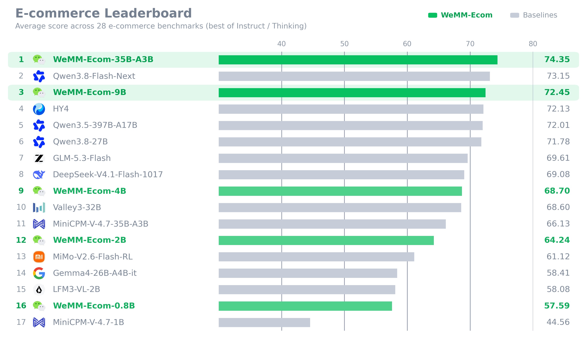
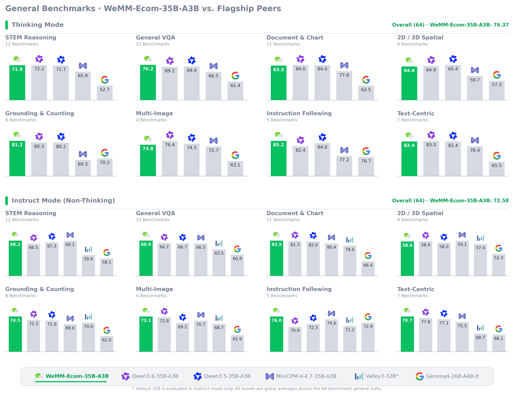
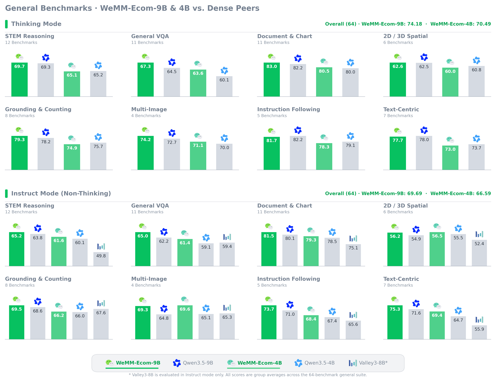
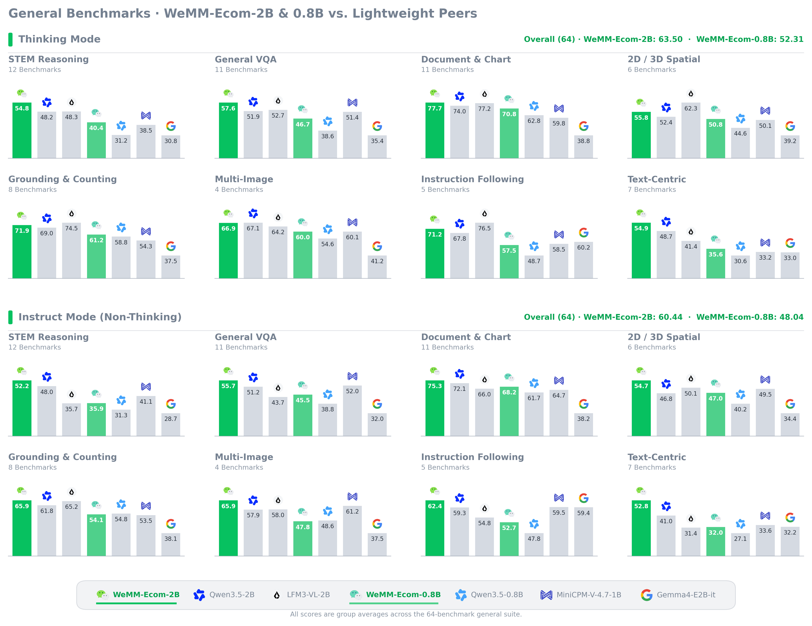

<h1 align="center">WeMM-Ecom</h1>

<p align="center">
  <b>Multimodal Foundation Models for E-Commerce and General Visual-Language Understanding</b>
</p>

<p align="center">
  <a href="https://huggingface.co/collections/tencent/wemm-ecom">🤗 Hugging Face</a> &nbsp;·&nbsp;
  <a href="https://arxiv.org/abs/2611.30662">📑 arXiv</a> &nbsp;·&nbsp;
  <a href="assets/WeMM_Ecom_tech_report.pdf">📄 Technical Report</a> &nbsp;·&nbsp;
  <a href="docs/serving.md">🚀 Serving Guide</a> &nbsp;·&nbsp;
  <a href="LICENSE">⚖️ Apache-2.0</a>
</p>

<p align="center">
  <a href="#overview">Overview</a> &nbsp;·&nbsp;
  <a href="#benchmarks">Benchmarks</a> &nbsp;·&nbsp;
  <a href="#model-weights">Model Weights</a> &nbsp;·&nbsp;
  <a href="#get-started">Get Started</a> &nbsp;·&nbsp;
  <a href="#citation">Citation</a>
  &nbsp;|&nbsp;
  <b>English</b> · <a href="README_zh.md">简体中文</a>
</p>

## Overview

**WeMM-Ecom** is a Chinese–English multimodal model family developed by WeChat Vision, spanning four dense models (0.8B, 2B, 4B, 9B) and a 35B-A3B MoE model (3B active parameters). The models are deployed across WeChat E-Commerce workloads including product understanding, multimodal search, compliance auditing, and livestream commerce.

- **🏆 E-commerce and general performance**: WeMM-Ecom-35B-A3B averages **74.35** across 28 e-commerce benchmarks, ahead of Qwen3.8-Flash-Next (73.15), HY4 (72.13), and Qwen3.5-397B-A17B (72.01). On 64 general benchmarks across 8 groups, all scales improve over size-matched Qwen3.5 in both Thinking and Instruct modes (**76.37** at 35B-A3B, **74.18** at 9B), and WeMM-Ecom-2B ranks #1 among lightweight peers (**63.50** Thinking / **60.44** Instruct).
- **⚡ Hybrid thinking in one checkpoint**: Every scale supports both fast Instruct (non-thinking) mode and multi-step Thinking mode in a single checkpoint.
- **🛠️ Standard architecture and quantization**: Uses upstream `transformers>=5.3.0` (`Qwen3_5ForConditionalGeneration` / `Qwen3_5MoeForConditionalGeneration`) with no custom patches, released in BF16, FP8, GPTQ, and GGUF for Transformers, vLLM, SGLang, and llama.cpp.

## Benchmarks

### E-commerce Leaderboard

<p align="center">
  <a href="assets/wemm-ecom-leaderboard.pdf">
    
  </a>
</p>

### General Benchmarks (Thinking & Instruct)

Group averages across 64 general benchmarks in **Thinking** (top) and **Instruct** (bottom) modes:

<p align="center">
  <a href="assets/wemm-ecom-general-35b.pdf">
    
  </a>
</p>

<details>
<summary><b>WeMM-Ecom-9B & 4B vs. Dense Peers</b> — 9B: 74.18 (Thinking) / 69.69 (Instruct) · 4B: 70.49 (Thinking) / 66.59 (Instruct)</summary>
<br>
<p align="center">
  <a href="assets/wemm-ecom-general-9b.pdf">
    
  </a>
</p>
</details>

<details>
<summary><b>WeMM-Ecom-2B & 0.8B vs. Lightweight Peers</b> — 2B: 63.50 (Thinking) / 60.44 (Instruct) · 0.8B: 52.31 (Thinking) / 48.04 (Instruct)</summary>
<br>
<p align="center">
  <a href="assets/wemm-ecom-general-lightweight.pdf">
    
  </a>
</p>
</details>

## Model Weights

| Model | Architecture | Weights |
| :--- | :--- | :--- |
| **WeMM-Ecom-35B-A3B** | MoE (3B active) | [🤗 **BF16**](https://huggingface.co/tencent/WeMM-Ecom-35B-A3B) &nbsp;·&nbsp; [🤗 **FP8**](https://huggingface.co/tencent/WeMM-Ecom-35B-A3B-FP8) &nbsp;·&nbsp; [🤗 **GPTQ**](https://huggingface.co/tencent/WeMM-Ecom-35B-A3B-GPTQ) &nbsp;·&nbsp; [🤗 **GGUF**](https://huggingface.co/tencent/WeMM-Ecom-35B-A3B-GGUF) |
| **WeMM-Ecom-9B** | Dense | [🤗 **BF16**](https://huggingface.co/tencent/WeMM-Ecom-9B) &nbsp;·&nbsp; [🤗 **FP8**](https://huggingface.co/tencent/WeMM-Ecom-9B-FP8) &nbsp;·&nbsp; [🤗 **GPTQ**](https://huggingface.co/tencent/WeMM-Ecom-9B-GPTQ) &nbsp;·&nbsp; [🤗 **GGUF**](https://huggingface.co/tencent/WeMM-Ecom-9B-GGUF) |
| **WeMM-Ecom-4B** | Dense | [🤗 **BF16**](https://huggingface.co/tencent/WeMM-Ecom-4B) &nbsp;·&nbsp; [🤗 **FP8**](https://huggingface.co/tencent/WeMM-Ecom-4B-FP8) &nbsp;·&nbsp; [🤗 **GPTQ**](https://huggingface.co/tencent/WeMM-Ecom-4B-GPTQ) &nbsp;·&nbsp; [🤗 **GGUF**](https://huggingface.co/tencent/WeMM-Ecom-4B-GGUF) |
| **WeMM-Ecom-2B** | Dense | [🤗 **BF16**](https://huggingface.co/tencent/WeMM-Ecom-2B) &nbsp;·&nbsp; [🤗 **FP8**](https://huggingface.co/tencent/WeMM-Ecom-2B-FP8) &nbsp;·&nbsp; [🤗 **GPTQ**](https://huggingface.co/tencent/WeMM-Ecom-2B-GPTQ) &nbsp;·&nbsp; [🤗 **GGUF**](https://huggingface.co/tencent/WeMM-Ecom-2B-GGUF) |
| **WeMM-Ecom-0.8B** | Dense | [🤗 **BF16**](https://huggingface.co/tencent/WeMM-Ecom-0.8B) &nbsp;·&nbsp; [🤗 **FP8**](https://huggingface.co/tencent/WeMM-Ecom-0.8B-FP8) &nbsp;·&nbsp; [🤗 **GPTQ**](https://huggingface.co/tencent/WeMM-Ecom-0.8B-GPTQ) &nbsp;·&nbsp; [🤗 **GGUF**](https://huggingface.co/tencent/WeMM-Ecom-0.8B-GGUF) |

See [docs/serving.md](docs/serving.md) for quantization details and runtime configurations.

## Get Started

### Transformers

```bash
pip install -r requirements.txt

python examples/transformers_inference.py \
  --model tencent/WeMM-Ecom-2B \
  --image assets/examples/product_0.jpg \
  --image assets/examples/product_1.jpg \
  --prompt "Describe this product, its packaging material, and the number of bowls shown."
```

Pass `--no-thinking` for Instruct mode.

<details>
<summary>Python API snippet</summary>

```python
import torch
from transformers import AutoModelForImageTextToText, AutoProcessor

model_id = "tencent/WeMM-Ecom-2B"
processor = AutoProcessor.from_pretrained(model_id)
model = AutoModelForImageTextToText.from_pretrained(
    model_id, dtype=torch.bfloat16, device_map="auto"
)

messages = [
    {
        "role": "user",
        "content": [
            {"type": "image", "image": "assets/examples/product_0.jpg"},
            {"type": "image", "image": "assets/examples/product_1.jpg"},
            {"type": "text", "text": "Briefly describe this product."},
        ],
    }
]
inputs = processor.apply_chat_template(
    messages, tokenize=True, return_dict=True, return_tensors="pt",
    add_generation_prompt=True, enable_thinking=False,
).to(model.device)
with torch.inference_mode():
    output = model.generate(**inputs, max_new_tokens=4096, do_sample=True, temperature=0.7, top_p=0.8, top_k=20)
print(processor.decode(output[0, inputs.input_ids.shape[1]:], skip_special_tokens=True))
```

</details>

### vLLM / SGLang / llama.cpp

```bash
vllm serve tencent/WeMM-Ecom-9B-FP8 \
  --served-model-name WeMM-Ecom \
  --reasoning-parser qwen3 \
  --max-model-len 32768
```

See [docs/serving.md](docs/serving.md) and [examples/README.md](examples/README.md) for vLLM, SGLang, llama.cpp, client calls, and sampling parameters.

## License

Code in this repository is licensed under the [Apache License 2.0](LICENSE). Model weights are governed by the `LICENSE` file in each Hugging Face repository.

## Citation

If you find this repository useful, please consider giving a star ⭐ and citation

```bibtex
@article{wemm-ecom,
      title={WeMM-Ecom: Advancing Multimodal Content Understanding for WeChat E-Commerce},
      author={Binhui Xie and Jinmin Li and Haomiao Tang and Guangting Wang and Song Jin and Jianwei Zhu and Fengyun Rao and Jing LYU},
      year={2026},
      eprint={2611.30662},
      archivePrefix={arXiv},
      primaryClass={cs.AI},
      url={https://arxiv.org/abs/2611.30662},
}
```
