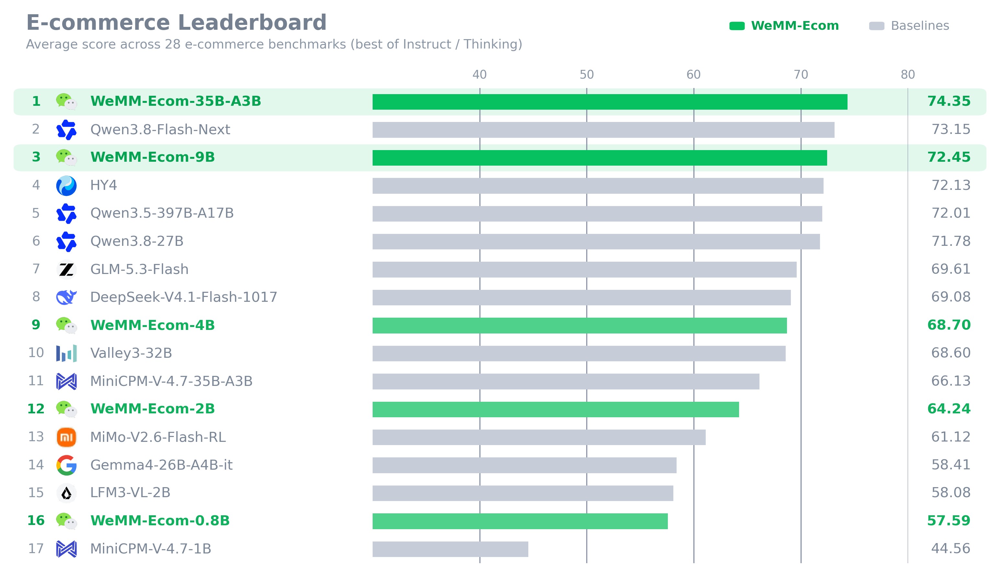
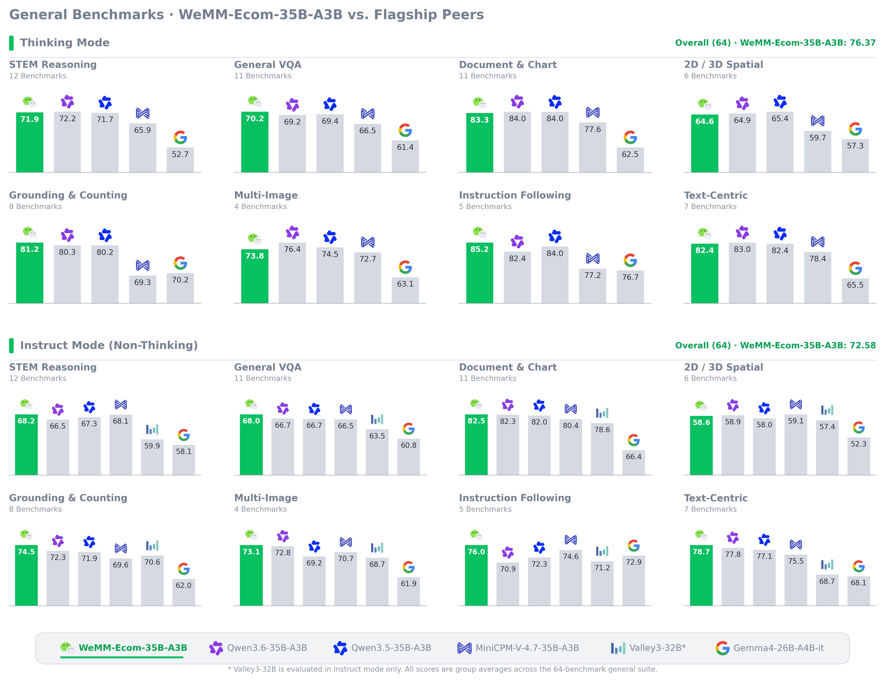
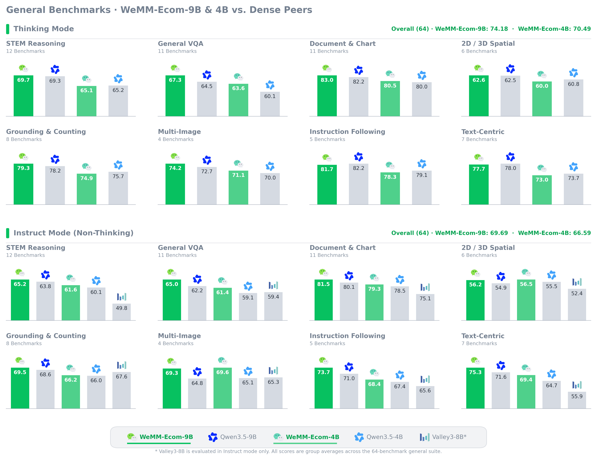
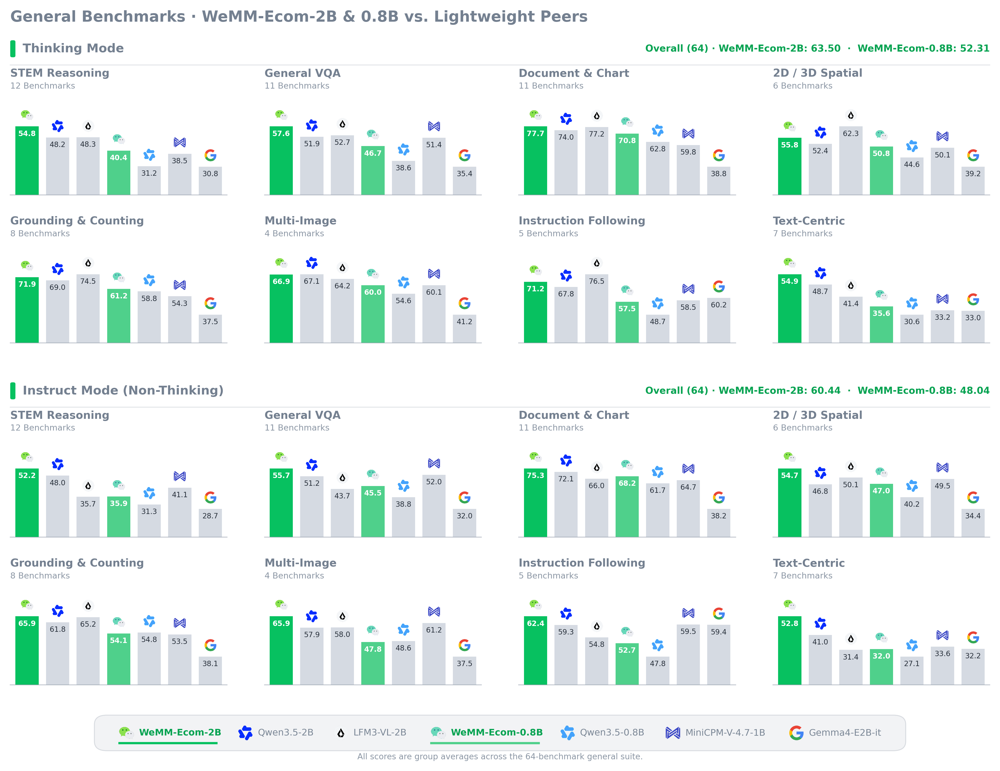

<h1 align="center">WeMM-Ecom</h1>

<p align="center">
  <b>面向电商场景与通用视觉语言理解的多模态基础模型系列</b>
</p>

<p align="center">
  <a href="https://huggingface.co/collections/tencent/wemm-ecom">🤗 Hugging Face</a> &nbsp;·&nbsp;
  <a href="assets/WeMM_Ecom_tech_report.pdf">📄 技术报告</a> &nbsp;·&nbsp;
  <a href="docs/serving.md">🚀 部署指南</a> &nbsp;·&nbsp;
  <a href="LICENSE">⚖️ Apache-2.0</a>
</p>

<p align="center">
  <a href="#模型概览">模型概览</a> &nbsp;·&nbsp;
  <a href="#评测结果">评测结果</a> &nbsp;·&nbsp;
  <a href="#模型权重">模型权重</a> &nbsp;·&nbsp;
  <a href="#开始使用">开始使用</a> &nbsp;·&nbsp;
  <a href="#引用">引用</a>
  &nbsp;|&nbsp;
  <a href="README.md">English</a> · <b>简体中文</b>
</p>

## 模型概览

**WeMM-Ecom** 是微信视觉团队研发的中英双语多模态基础模型系列，包含 0.8B、2B、4B、9B 四款稠密模型和 35B-A3B 混合专家模型（激活参数 3B），已应用于微信电商的商品理解、多模态搜索、合规审核与直播电商等业务。

- **🏆 电商与通用表现**：WeMM-Ecom-35B-A3B 在 28 个电商评测集上均分为 **74.35**，高于 Qwen3.8-Flash-Next（73.15）、HY4（72.13）和 Qwen3.5-397B-A17B（72.01）。在 64 个通用基准（8 个能力分组）上，各尺寸在 Thinking 与 Instruct 模式下均优于同规模 Qwen3.5（35B-A3B 为 **76.37**，9B 为 **74.18**），WeMM-Ecom-2B 在轻量级模型中排名第一（Thinking **63.50** / Instruct **60.44**）。
- **⚡ 单权重混合思考**：全系列在单一权重内同时支持快速直答的 Instruct（非思考）模式与多步推理的 Thinking（思考）模式。
- **🛠️ 原生架构与多格式量化**：直接兼容上游 `transformers>=5.3.0`（`Qwen3_5ForConditionalGeneration` / `Qwen3_5MoeForConditionalGeneration`），无需额外代码修改；同步提供 BF16、FP8、GPTQ 与 GGUF 权重，支持 Transformers、vLLM、SGLang 与 llama.cpp。

## 评测结果

### 电商榜单（E-commerce Leaderboard）

<p align="center">
  <a href="assets/wemm-ecom-leaderboard.pdf">
    
  </a>
</p>

### 通用能力分组（Thinking & Instruct）

64 个通用基准按 8 大能力分组的均分对比，上半部分为 **Thinking 模式**，下半部分为 **Instruct（非思考）模式**：

<p align="center">
  <a href="assets/wemm-ecom-general-35b.pdf">
    
  </a>
</p>

<details>
<summary><b>WeMM-Ecom-9B & 4B 稠密模型对比</b> — 9B：74.18（Thinking）/ 69.69（Instruct）· 4B：70.49（Thinking）/ 66.59（Instruct）</summary>
<br>
<p align="center">
  <a href="assets/wemm-ecom-general-9b.pdf">
    
  </a>
</p>
</details>

<details>
<summary><b>WeMM-Ecom-2B & 0.8B 轻量级模型对比</b> — 2B：63.50（Thinking）/ 60.44（Instruct）· 0.8B：52.31（Thinking）/ 48.04（Instruct）</summary>
<br>
<p align="center">
  <a href="assets/wemm-ecom-general-lightweight.pdf">
    
  </a>
</p>
</details>

## 模型权重

| 模型 | 架构 | 模型权重 |
| :--- | :--- | :--- |
| **WeMM-Ecom-35B-A3B** | MoE（3B 激活） | [🤗 **BF16**](https://huggingface.co/tencent/WeMM-Ecom-35B-A3B) &nbsp;·&nbsp; [🤗 **FP8**](https://huggingface.co/tencent/WeMM-Ecom-35B-A3B-FP8) &nbsp;·&nbsp; [🤗 **GPTQ**](https://huggingface.co/tencent/WeMM-Ecom-35B-A3B-GPTQ) &nbsp;·&nbsp; [🤗 **GGUF**](https://huggingface.co/tencent/WeMM-Ecom-35B-A3B-GGUF) |
| **WeMM-Ecom-9B** | 稠密 | [🤗 **BF16**](https://huggingface.co/tencent/WeMM-Ecom-9B) &nbsp;·&nbsp; [🤗 **FP8**](https://huggingface.co/tencent/WeMM-Ecom-9B-FP8) &nbsp;·&nbsp; [🤗 **GPTQ**](https://huggingface.co/tencent/WeMM-Ecom-9B-GPTQ) &nbsp;·&nbsp; [🤗 **GGUF**](https://huggingface.co/tencent/WeMM-Ecom-9B-GGUF) |
| **WeMM-Ecom-4B** | 稠密 | [🤗 **BF16**](https://huggingface.co/tencent/WeMM-Ecom-4B) &nbsp;·&nbsp; [🤗 **FP8**](https://huggingface.co/tencent/WeMM-Ecom-4B-FP8) &nbsp;·&nbsp; [🤗 **GPTQ**](https://huggingface.co/tencent/WeMM-Ecom-4B-GPTQ) &nbsp;·&nbsp; [🤗 **GGUF**](https://huggingface.co/tencent/WeMM-Ecom-4B-GGUF) |
| **WeMM-Ecom-2B** | 稠密 | [🤗 **BF16**](https://huggingface.co/tencent/WeMM-Ecom-2B) &nbsp;·&nbsp; [🤗 **FP8**](https://huggingface.co/tencent/WeMM-Ecom-2B-FP8) &nbsp;·&nbsp; [🤗 **GPTQ**](https://huggingface.co/tencent/WeMM-Ecom-2B-GPTQ) &nbsp;·&nbsp; [🤗 **GGUF**](https://huggingface.co/tencent/WeMM-Ecom-2B-GGUF) |
| **WeMM-Ecom-0.8B** | 稠密 | [🤗 **BF16**](https://huggingface.co/tencent/WeMM-Ecom-0.8B) &nbsp;·&nbsp; [🤗 **FP8**](https://huggingface.co/tencent/WeMM-Ecom-0.8B-FP8) &nbsp;·&nbsp; [🤗 **GPTQ**](https://huggingface.co/tencent/WeMM-Ecom-0.8B-GPTQ) &nbsp;·&nbsp; [🤗 **GGUF**](https://huggingface.co/tencent/WeMM-Ecom-0.8B-GGUF) |

量化规格与推理部署参数见 [docs/serving.md](docs/serving.md)。

## 开始使用

### Transformers

```bash
pip install -r requirements.txt

python examples/transformers_inference.py \
  --model tencent/WeMM-Ecom-2B \
  --image assets/examples/product_0.jpg \
  --image assets/examples/product_1.jpg \
  --prompt "请简要描述该商品的品类、包装材质以及图中茶碗的数量。"
```

添加 `--no-thinking` 即可切换为 Instruct（非思考）模式。

<details>
<summary>Python 调用示例</summary>

```python
import torch
from transformers import AutoModelForImageTextToText, AutoProcessor

model_id = "tencent/WeMM-Ecom-2B"
processor = AutoProcessor.from_pretrained(model_id)
model = AutoModelForImageTextToText.from_pretrained(
    model_id, dtype=torch.bfloat16, device_map="auto"
)

messages = [
    {
        "role": "user",
        "content": [
            {"type": "image", "image": "assets/examples/product_0.jpg"},
            {"type": "image", "image": "assets/examples/product_1.jpg"},
            {"type": "text", "text": "请简要描述该商品。"},
        ],
    }
]
inputs = processor.apply_chat_template(
    messages, tokenize=True, return_dict=True, return_tensors="pt",
    add_generation_prompt=True, enable_thinking=False,
).to(model.device)
with torch.inference_mode():
    output = model.generate(**inputs, max_new_tokens=4096, do_sample=True, temperature=0.7, top_p=0.8, top_k=20)
print(processor.decode(output[0, inputs.input_ids.shape[1]:], skip_special_tokens=True))
```

</details>

### vLLM / SGLang / llama.cpp

```bash
vllm serve tencent/WeMM-Ecom-9B-FP8 \
  --served-model-name WeMM-Ecom \
  --reasoning-parser qwen3 \
  --max-model-len 32768
```

完整的 vLLM、SGLang、llama.cpp 启动命令、客户端调用示例及推荐采样参数请见 [docs/serving.md](docs/serving.md) 与 [examples/README.md](examples/README.md)。

## 许可证

本仓库源码采用 [Apache License 2.0](LICENSE) 协议，各模型权重遵守对应 Hugging Face 仓库中的 `LICENSE` 协议。

## 引用

如果本仓库对您有帮助，欢迎点亮 Star ⭐ 并引用：

```bibtex
@article{wemm-ecom,
      title={WeMM-Ecom: Advancing Multimodal Content Understanding for WeChat E-Commerce},
      author={Binhui Xie and Jinmin Li and Haomiao Tang and Guangting Wang and Song Jin and Jianwei Zhu and Fengyun Rao and Jing LYU},
      year={2026},
      eprint={},
      archivePrefix={arXiv},
      primaryClass={cs.AI},
      url={https://arxiv.org/abs/},
}
```
